# RaveBSD

Self-hostable feature-rich instance of [RaveBookSearch](https://ravebooksearch.com).

Search many free book and audiobook sources at once, from your own machine. RaveBSD merges the results into one ranked list and finds direct download links for you. From 2.0 it also downloads books to your server, names and shelves them for you, and saves copies to any of your devices.

> RaveBookSearch will be sunset soon, RaveBSD will be the only way to access its features moving forward. It was a good run, but the website has gotten too popular for its own good. I didn't want to completely shut it down though, so this was the next best way to keep it alive and improve on the features in ways that were previously restricted.

> **2.0 is a breaking update.** If you run 1.x, read [Upgrading from 1.x](#upgrading-from-1x) before you update. Updating the image alone is not enough.

## Screenshots

Click any screenshot to see it full size.

**Desktop**

<table>
<tr><td valign="top" align="center" width="50%"><a href="screenshots/desktop-discover.png">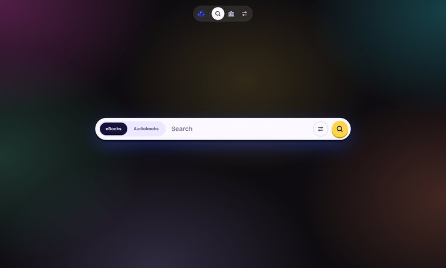</a><br><sub>Discover</sub></td><td valign="top" align="center" width="50%"><a href="screenshots/desktop-advanced-search.png">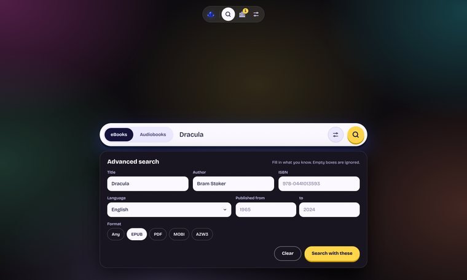</a><br><sub>Advanced search</sub></td></tr>
<tr><td valign="top" align="center" width="50%"><a href="screenshots/desktop-searching.png">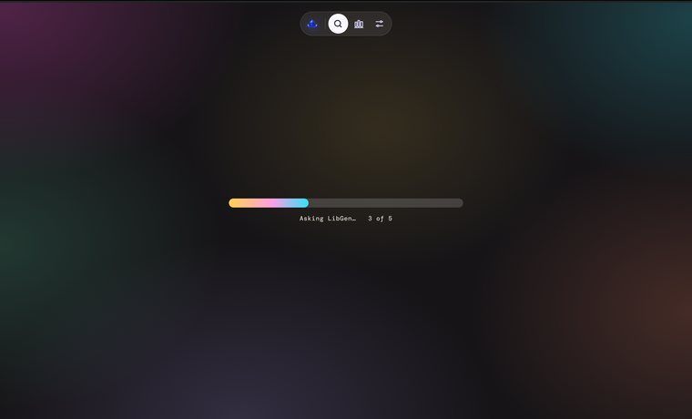</a><br><sub>Searching</sub></td><td valign="top" align="center" width="50%"><a href="screenshots/desktop-settings-libraries.png">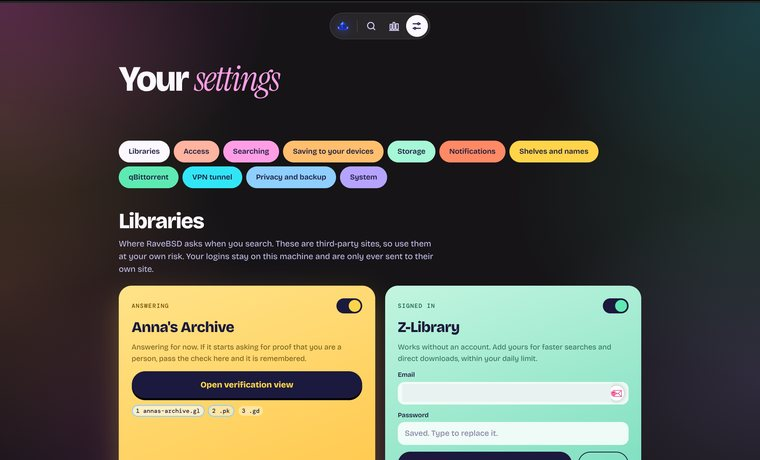</a><br><sub>Settings</sub></td></tr>
<tr><td valign="top" align="center" width="50%"><a href="screenshots/desktop-results-ebooks.png">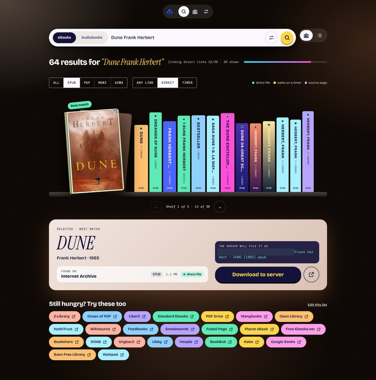</a><br><sub>eBook results</sub></td><td valign="top" align="center" width="50%"><a href="screenshots/desktop-results-audiobooks.png">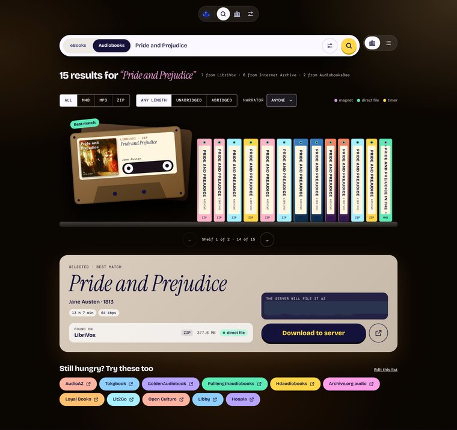</a><br><sub>Audiobook results</sub></td></tr>
<tr><td valign="top" align="center" width="50%"><a href="screenshots/desktop-shelf.png">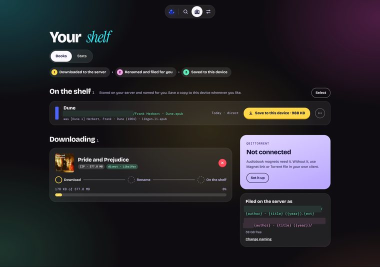</a><br><sub>Your shelf</sub></td><td valign="top" align="center" width="50%"><a href="screenshots/desktop-stats.png">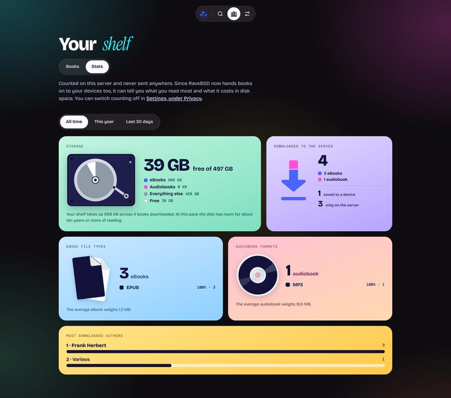</a><br><sub>Stats</sub></td></tr>
</table>

**Phone**

<table>
<tr><td valign="top" align="center" width="25%"><a href="screenshots/phone-discover.png">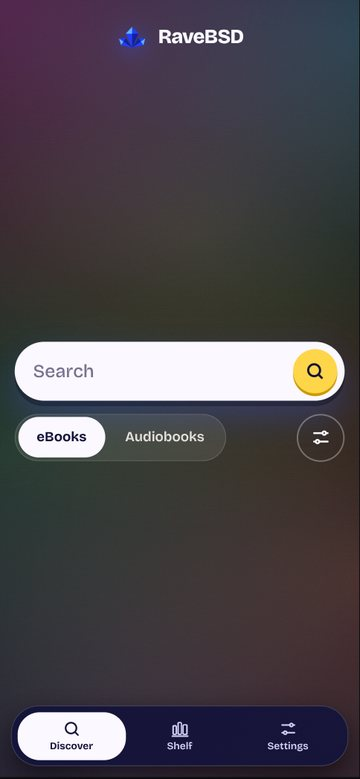</a><br><sub>Discover</sub></td><td valign="top" align="center" width="25%"><a href="screenshots/phone-searching.png">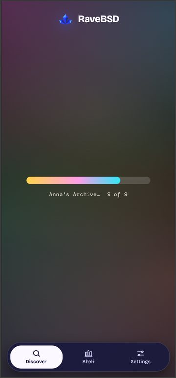</a><br><sub>Searching</sub></td><td valign="top" align="center" width="25%"><a href="screenshots/phone-results-ebooks.png">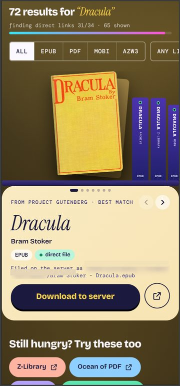</a><br><sub>eBook results</sub></td><td valign="top" align="center" width="25%"><a href="screenshots/phone-results-audiobooks.png">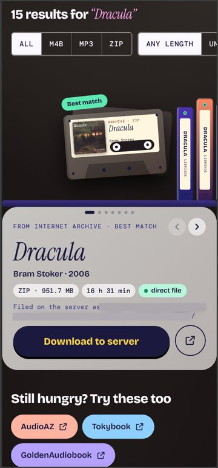</a><br><sub>Audiobook results</sub></td></tr>
<tr><td valign="top" align="center" width="25%"><a href="screenshots/phone-shelf.png">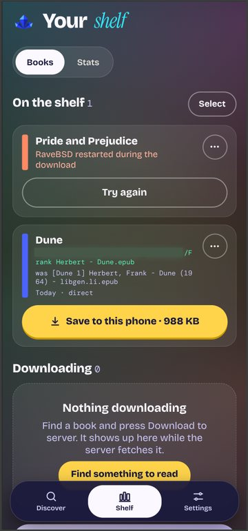</a><br><sub>Your shelf</sub></td><td valign="top" align="center" width="25%"><a href="screenshots/phone-stats.png">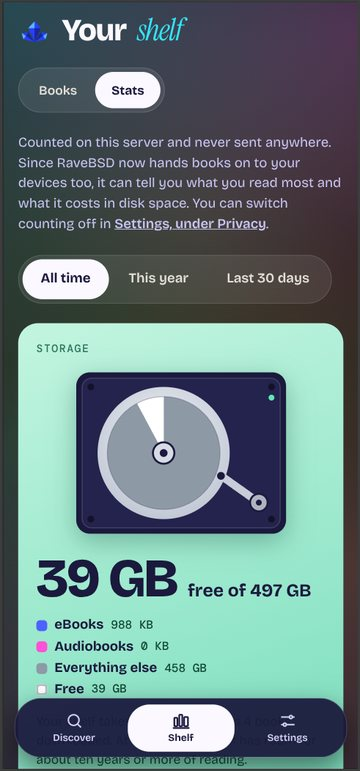</a><br><sub>Stats</sub></td><td valign="top" align="center" width="25%"><a href="screenshots/phone-settings.png">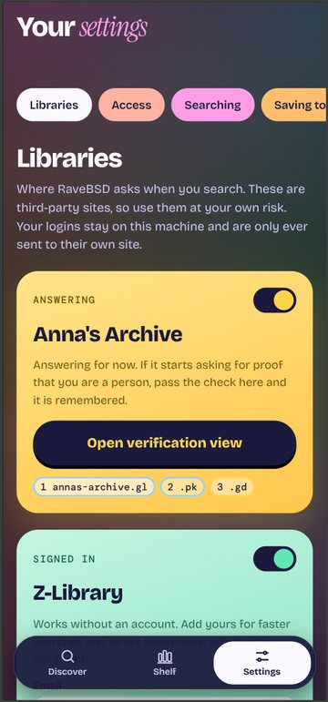</a><br><sub>Settings</sub></td></tr>
</table>

## What's new in 2.0

- **A new look.** Results sit on a bookshelf (audiobooks as cassettes), or in a list. Works on phones as well as it does on desktops.
- **Downloads to your server.** Press Download and the server fetches the book, renames it your way (for example `Frank Herbert/Dune (1965).epub`) and files it in your eBooks or audiobooks folder. Audiobooks arrive as a folder of numbered tracks with the cover alongside, or as one file when the book is a single M4B.
- **Your shelf.** Everything on the server in one place, ready to save to whichever device you are on. eBooks can save themselves automatically.
- **Stats.** What you read most and what it costs in disk space. Counted on your server only.
- **qBittorrent.** Audiobook magnets go straight to your qBittorrent, and finished torrents are renamed and shelved like everything else.
- **VPN.** Send searches and downloads through a VPN with [Gluetun](https://github.com/qdm12/gluetun), and pause searches and downloads if the tunnel drops.
- **Three ways to run it.** Just for you, for friends and family with their own logins, or open to the public. See [Who can use it](#who-can-use-it).
- **Working mirrors first.** Mirror status from [SLUM](https://open-slum.org) decides which LibGen, Anna's Archive and Z-Library domains are tried first.
- **Notifications** when a download lands on your shelf or space runs low. Allow them in Settings under This browser (browsers only allow them over HTTPS or on `localhost`); the admin panel picks which ones are sent.

## Sources

**eBooks**

| Source | Notes |
| --- | --- |
| LibGen | Tries another mirror when one is down or overloaded |
| Anna's Archive | May ask for a one-time human check, which you complete yourself in the admin panel under Libraries |
| Z-Library | Works without an account. Adding your login makes it faster and gives direct downloads within your daily limit |
| Internet Archive | Lending-library items are left out |
| Project Gutenberg | |
| Standard Ebooks | Carefully produced public-domain EPUBs, in English |
| Libronera | Spanish eBooks. Search only: downloads need a password the site shows on each book's page, so results open that page |
| Ebookelo | Mostly Spanish eBooks, as magnet links sent to qBittorrent or copied |
| Wikisource | English Wikisource's public-domain texts, made into an EPUB when you download one |
| OpenStax | |
| LibreTexts | |
| Memory of the World | |
| RoyalLib | Russian-language library. Refuses connections from some countries |
| Mobilism | Needs a free account |

**Audiobooks**

| Source | Notes |
| --- | --- |
| AudiobookBay | Magnet links, sent to qBittorrent or copied, with an optional .torrent download |
| LibriVox | Whole recordings, with running time and readers |
| AudiobooksBee | Links to the file host |
| Internet Archive | Whole books, every track in one download, with running time |
| LibGen | Only the audio files it happens to hold |
| Mobilism | Needs a free account |

The results page also has link pills for many more sites that can only be opened in your browser. Add, remove or reset them in the admin panel under Libraries.

## Install

You need [Docker](https://docs.docker.com/get-docker/) with Compose.

```
git clone https://github.com/IdleEndeavor/RaveBSD.git
cd RaveBSD
mkdir data books audiobooks downloads
cp .env.example .env
docker compose up -d
```

Open <http://localhost:8080>. The first run asks who RaveBSD is for, where your books should live and whether to connect qBittorrent. Everything is included, including the background browser that some sources need, so there is nothing else to set up.

**Settings** (in the nav bar) holds the options for your own browser and account. Everything else, from source logins to folders, accounts and API keys, is in the **admin panel**: the button at the bottom of Settings. Optional settings can also go in `.env`.

If `id -u` or `id -g` is not 1000, set `PUID` and `PGID` in `.env` before starting, otherwise RaveBSD cannot save into `data/` or your book folders.

**Books somewhere else?** Set `BOOKS_PATH` and `AUDIOBOOKS_PATH` in `.env` to the folders you want, for example the ones your reading apps already use.

**Port 8080 already taken?** Set `PORT` in `.env` to any free port (for example `PORT=8686`) and run `docker compose up -d` again. Without Docker, start it with `PORT=8686 npm start`.

**Without Docker:** install Node 24, then run `npm install` and `npm start`. The background browser is downloaded automatically. Books go in `data/books` and `data/audiobooks` unless you pick other folders at first run.

**qBittorrent and Gluetun** are ready to go in `compose.yaml`: uncomment them and follow the notes there. If you edit `compose.yaml`, `./update.sh` cannot update it when a new version changes it too (it says so and updates the image only). Compose also reads a `compose.override.yaml` next to it, so your own changes can live there instead.

## Update

```
./update.sh
```

It pulls the newest version, including any changes to `compose.yaml`, and restarts RaveBSD. Your `data/` folder and your books are untouched. The running version is shown at the bottom of Settings.

To update automatically, run it from cron, for example every night at 4:

```
0 4 * * * cd /path/to/RaveBSD && ./update.sh
```

## Upgrading from 1.x

2.0 changes how RaveBSD is set up, so a 1.x install needs these steps once:

```
cd /path/to/RaveBSD
git pull
mkdir -p books audiobooks downloads
docker compose pull
docker compose up -d
```

`git pull` matters: 2.0's `compose.yaml` adds the folders your books are saved to and a profile that keeps the background browser sandboxed. With the old `compose.yaml`, downloaded books stay inside the container and are lost when it is recreated. From now on `./update.sh` does this for you.

What changes:

- The **Backend page is gone.** Its options are in Settings and the admin panel.
- The **first-run setup** opens once, so you can pick who RaveBSD is for and where books go.
- Your **settings and source logins carry over.**
- **Stats start again.** 1.x counted searches, 2.0 counts downloads, so the old numbers are not carried over.
- `/api/v1/search` **still works** with the same `X-API-Key` header. Answers have a few more fields.

## Who can use it

Pick one at first run, and change it later in the admin panel under Access.

| Mode | For | Signing in |
| --- | --- | --- |
| Just me | One person | Optional password |
| Friends and family | People you know, sharing one shelf | Everyone signs in with an account you make in the admin panel. Users search, download and save; admins also run the server |
| Public | Anyone with the link | Visitors need no account. Each sees only their own downloads, within a space limit, and they are cleared after a week (both adjustable). Everything else needs the admin sign-in |

Notes:

- Admins can sign out every device at once in the admin panel under Access.
- On a public instance there are no API keys, and folders, logins and addresses stay hidden from visitors.
- `PUBLIC_INSTANCE=1` in `.env` fixes the instance to public.

## Access it from outside your home

The safest way to reach your instance from other places is still [Tailscale](https://tailscale.com) (private to your own devices) or a [Cloudflare Tunnel](https://developers.cloudflare.com/cloudflare-one/connections/connect-networks/) with Cloudflare Access in front (your own domain, with a login). Point either one at the port RaveBSD runs on.

If you open it to the internet yourself, use Friends and family or Public, never Just me without a password. Behind a reverse proxy, set `TRUST_PROXY=1` in `.env` so sign-in and visitor limits see each visitor's own address.

Just me without a password only answers to IP addresses, `localhost` and local names (`.local`, `.lan`, `.ts.net` and similar), so other websites cannot reach it through DNS tricks. If you open it by another name, list it in `ALLOWED_HOSTS`.

## Your data

Everything RaveBSD saves is in the `data/` folder next to `compose.yaml`, and your books are in `books/` and `audiobooks/` (or the folders you chose):

| File | What it holds |
| --- | --- |
| `settings.json` | Your settings, source logins and accounts (passwords are stored hashed) |
| `shelf.json` | The list of books on your shelf |
| `stats.json` | Download counts per day |
| `browser-profile/` | The background browser's saved state, including a passed Anna's Archive check |

- Nothing is sent anywhere except to the sources you search and the sites your downloads come from. The only other requests are to [SLUM](https://open-slum.org) every 30 minutes for mirror status (switch it off under Libraries), to a public torrent cache (itorrents.org) when you press Torrent file on an audiobook, to GitHub when you press Check now (for updates) and to Project Gutenberg when you press Check connection, both in the admin panel under System. Outside Docker, the background browser is also downloaded once from Playwright when you install. None of them carry your searches.
- Searches themselves are never saved, and they are not written to the logs. Recent results stay in memory for 10 minutes to speed up repeat searches and are gone after a restart.
- Stats can be switched off in the admin panel under Privacy and backup ("Keep stats"). Switching them off also deletes what was counted.

## Backup and restore

Back up the whole deployment by copying the project folder, or just the parts that matter:

```
tar czf ravebsd-backup.tgz compose.yaml .env data books audiobooks
```

To restore, unpack the archive on any machine with Docker and run `docker compose up -d` again.

For settings only, the admin panel has a backup file under Privacy and backup: settings, source logins, the shelf list and stats in one file, without the books. It holds your logins, so keep it private.

## Contributions

All contributions and improvements are welcome: fixes, new sources, translations, design, docs. Open an issue or a pull request on GitHub.

Every folder in the repository has a `development-aide.md` that explains what that part of RaveBSD does, how it connects to the rest, the names worth knowing (files, functions, classes, routes) and the rules it follows. Start with [`src/development-aide.md`](src/development-aide.md) for the server and [`public/js/development-aide.md`](public/js/development-aide.md) for the page. Run `npm test` before sending a change.

Thanks to [@matsver](https://github.com/matsver) for the first pull request ([#1](https://github.com/IdleEndeavor/RaveBSD/pull/1)), which updated the LibGen scraper to search by ISBN.

## Future plans

- Integration as a source for locally hosted instances of 4get search and SearXNG
- Integration as a plugin for Calibre

## Donations (Thank YOU!)
<a href="https://www.buymeacoffee.com/parsleyafterglow" target="_blank"></a>

## Contact
ravesearch.nmmw4@aleeas.com
